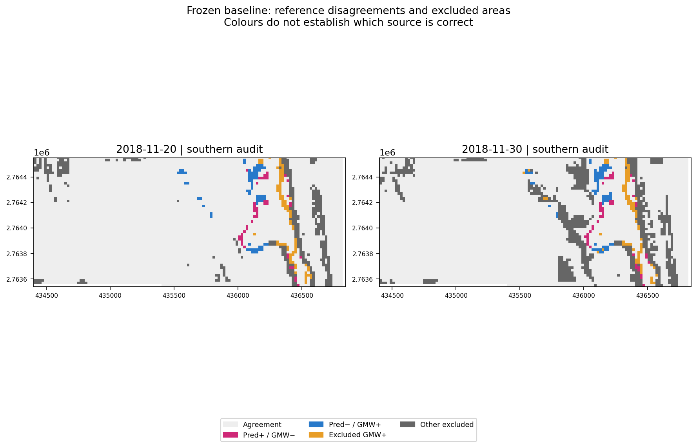

# Mangrove Pulse

*From satellite evidence to targeted mangrove inspection.*

<p align="center">
  <a href="https://spaceacademy-hackathons.space.gov.ae/"></a>
  <a href="requirements.txt"></a>
  <a href="Mangrove_Pulse_Review.ipynb"></a>
  <br>
  <a href="docs/PROVENANCE.md"></a>
  <a href="docs/TARIF_SCENE_QUALIFICATION.md"></a>
  <a href="docs/CONNECTED_CONCEPT_ASSESSMENT.md"></a>
</p>

Arab Youth Space Hackathon: 813 Challenge

[Results notebook](Mangrove_Pulse_Review.ipynb) · [Inspection briefs](docs/CASES.md) · [Evidence map](docs/CLAIM_EVIDENCE_MAP.md) · [Official starter repository](https://github.com/Tnecniv-Teikram/813-hyperspectral-hackathon)

- **Working feature:** review satellite/reference disagreements and turn selected patches into inspection briefs.
- **Main result:** F1 0.8864 against GMW on 5,653 quality-screened southern cells, not independent field accuracy.
- **Coverage:** 468 cells are excluded on the primary date; treating exclusions as negative predictions gives F1 0.8194.
- **Drone:** a proposed amphibious contact-sensing platform, with conditional tradeoffs rather than measured superiority.
- **Next evidence:** independent dated cover labels, accepted observations and matched missions; ecological benefit needs a separate controlled study.
- **Start here:** [results notebook](Mangrove_Pulse_Review.ipynb), [C001 inspection brief](docs/C001_INSPECTION_BRIEF.md) and [platform assessment](docs/CONNECTED_CONCEPT_ASSESSMENT.md).

## Table of contents

- [Overview](#overview)
- [Completed, proposed and future work](#completed-proposed-and-future-work)
- [Conditional drone tradeoffs](#conditional-drone-tradeoffs)
- [Team and contributors](#team-and-contributors)
- [Repository structure](#repository-structure)
- [Notebook guide](#notebook-guide)
- [Repository contents](#repository-contents)
- [Run and review](#run-and-review)
  - [Installation and commands](#installation-and-commands)
- [Data and method](#data-and-method)
- [Recorded results](#recorded-results-agreement-with-gmw-not-field-accuracy)
- [Reference sensitivity](#supplementary-result-reference-sensitivity)
- [Useful contribution and review cases](#useful-contribution-and-review-cases)
- [Limitations and next gate](#limitations-and-next-gate)
- [License and attribution](#license-and-attribution)
- [Related resources](#related-resources)

## Overview

Mangrove Pulse helps analysts review uncertain satellite evidence about mangrove cover. The workflow finds disagreements between a simple satellite baseline and a mangrove extent map, records areas excluded by quality screening, and turns selected patches into inspection briefs.

The [claim-to-evidence map](docs/CLAIM_EVIDENCE_MAP.md) links each result to its evidence and explains what still needs testing.

For a concise account of demonstrated results and claims still needing field evidence, read [what the PoC establishes](docs/WHAT_THE_POC_ESTABLISHES.md).

We designed the briefs for analysts deciding what evidence an ambiguous patch needs next. We have not yet tested them with a monitoring team or secured a field partner or site access. The demonstration uses 2018 imagery and does not recommend intervention today.

**Theme:** Ecosystem Health, Biodiversity & Blue Carbon. **Team:** Mangrove Pulse.

For the 20 November 2018 scene, 121 cells in the southern evaluation area disagree with the original reference and 87 mapped cells are excluded by quality screening. These counts identify questions about cover and data quality, not ecological damage. Each brief uses the satellite location, acquisition date and quality record to explain what evidence to request next. We propose comparing this process with manual map and image review; we have not measured an improvement to a practitioner's workflow or a business benefit.

## Completed, proposed and future work

The implemented workflow reviews satellite evidence at Khor Kalba. The amphibious drone is a proposed inspection platform, with no physical prototype or operational tests.

C001 and C017 ask for dated cover evidence. Archived imagery or ordinary photography may answer those questions without amphibious hardware. A separate proposed task compares conductivity and temperature at two water stations. Its [mission comparison](docs/WATER_CONTACT_RATIONALE.md#one-refutable-task-comparison) asks which method can return equivalent accepted observations with the least burden. Historical review cells do not establish a chemical problem or a need for planting. Khor Kalba remains the demonstration site; we would change sites only after a source-qualified, executed comparison showed a stronger case.

| Status | Scope |
|---|---|
| Completed | Reproducible Sentinel-2/GMW reference-agreement analysis, held-out evaluation, disagreement and coverage audit, three historical Khor Kalba review cases, a separate GMW 2018 reference-sensitivity comparison with later WorldCover 2020 context, and separately dated 24 September 2026 SCL/TCI site context. Three inspection briefs demonstrate possible handoffs to a reviewer. |
| Proposed integration | Transfer locations, evidence and unanswered questions to a field-inspection workflow. A drone is a candidate for collecting closer observations; its usefulness remains untested. |
| Future research | Test amphibious mobility and sensing feasibility separately. Consider planting only after establishing ecological need and suitability, followed by separate intervention and survival trials. |

The [inspection handoff](docs/DRONE_KHOR_KALBA_HANDOFF.md) connects all 85 original cell centres to observation questions, possible collection methods and blank return records. It also includes hypothetical mission-energy scenarios. The cases demonstrate how to organize a review request; they do not establish ecological conditions, operational value or drone performance. "Hyper drone" is the concept's name, not a claim that hyperspectral sensing is implemented.

[Published Khor Kalba site evidence](docs/KHOR_KALBA_SITE_EVIDENCE.md) provides local context, with the dates and limits of each source recorded.

[SkyPlanter's published prototype](https://portal.findresearcher.sdu.dk/en/publications/skyplanter-aerial-reforestation-with-an-ultralight-seedling-plant/) demonstrates terrestrial seedling placement, and published amphibious sensing work demonstrates other components. Neither tests our combined concept, bio-seed-pod mechanism or mangrove establishment. The [connected assessment](docs/CONNECTED_CONCEPT_ASSESSMENT.md#demonstrated-components-and-the-proposed-integration) asks whether EO-guided access and water-supported sensing could improve a defined observation task at equivalent measurement quality. We have not established novelty or superiority. Published UAE porewater and tree measurements also require methods that a floating channel probe cannot replace.

The [symbolic resource audit](docs/SYMBOLIC_RESOURCE_GATES.md) sets conditional limits on energy, battery capacity, dwell and accepted observations. A free-CPU SymPy run checked seven identities and two rational relations; the executed notebook and results are included. These calculations can reject assumptions within the model, but they do not measure aircraft performance or ecological benefit. They require no further satellite acquisition.

The [historical Kalba workbook](docs/HISTORICAL_KALBA_FIELD_CONTEXT.md) contains 2014 and undated field records. Gaps in spatial support and measurement definitions limit their use to context. We also checked an [Abu Dhabi species-presence record from 8 May 2018](docs/HISTORICAL_KALBA_FIELD_CONTEXT.md#a-dated-alternative-site-field-presence-lead). Neither source provides whole-cell labels for the 2018 cases, validates our aircraft or justifies a site switch.

The [water-contact rationale](docs/WATER_CONTACT_RATIONALE.md) uses official historical water-property evidence to motivate a separate conductivity/temperature question and compare collection methods. A successful free-Colab run supplies [24 September 2026 site context](docs/DATED_EO_CONTEXT.md): provider TCI imagery, native 20 m SCL labels and a reusable crop cache. These products describe display and quality context, not field cover, chemical measurements or ecological change. The [question contract](examples/inspection/water_context_question.json) has no assigned stations or collected observations. EnMAP data access returned a login page rather than imagery.

## Conditional drone tradeoffs

The [Tarif hyperspectral qualification](docs/TARIF_SCENE_QUALIFICATION.md), executed on 9 October, read surface-reflectance channels using 2.22 MB of imagery rather than downloading the full 1.11 GB cube. The fixed window shows open water. It demonstrates bounded data access, but provides no mangrove-accuracy result, hyperspectral improvement or evidence of drone or ecological performance. The executed notebook, figure and reusable cache are included. Kalba remains the primary demonstration; older notebooks retain their original scope.

Published aircraft tests are discussed separately in the [external tradeoff review](docs/CONNECTED_CONCEPT_ASSESSMENT.md#measured-third-party-tradeoffs).

The [saved Colab scenarios](examples/inspection/energy_scenario_excerpt.json) compare hover and water-supported sensing under hypothetical inputs. The [symbolic audit](docs/SYMBOLIC_RESOURCE_GATES.md) derives the general conditions. Both are analytical comparisons; neither validates the aircraft inputs.

The examples assume an 8 kg aircraft and payload, 2 kg of added support, three tasks, 300 seconds of travel and 30 seconds of extra airborne transition per task. Observation quality is assumed equal. The battery is 240 Wh nominal with an assumed usable fraction of 0.8, giving 192 Wh. These tasks are separate from the 85 historical cell centres and do not define authorized stations.

The [saved inputs](examples/inspection/energy_scenario_excerpt.json) specify 0.8 m² total rotor disk area, air density 1.225 kg/m³, gravity 9.81 m/s², an uncalibrated loss multiplier of 1.6, a common airborne load of 25 W and total supported draw of 40 W. The [model](examples/inspection/energy_source/sampling_energy_model.py) uses ideal induced power `(m*g)^1.5 / sqrt(2*rho*A)`, then multiplies it by 1.6 and adds 25 W. This gives about 819.567 W at 8 kg and 1,135.441 W at 10 kg. The additive load means total power does not scale exactly as mass to the 1.5 power. All design and mission inputs are hypothetical; travel is charged at this static power estimate, not a measured forward-flight curve.

| Saved scenario | Hover energy | Supported energy | Accounted hover / supported time | Conditional design consequence |
|---|---:|---:|---:|---|
| 30 seconds dwell per task | 88.786 Wh | 124.006 Wh | 390 / 480 s | Support loses on modeled energy and time at equal acceptance. |
| 150 seconds dwell per task | 170.743 Wh | 128.006 Wh | 750 / 840 s | Support saves about 25.03% modeled energy but takes 90 seconds longer. This is a tradeoff, not overall superiority. |
| Energy-only sensitivity: 150 seconds dwell plus 80 Wh extra support overhead | 170.743 Wh | 208.006 Wh | 750 / 840 s accounted subtotal; extra duration unspecified | Support loses the energy comparison and exceeds the assumed battery budget. This is not a complete mission-time comparison. |

With zero extra energy overhead, the model breaks even at 84.214 seconds of dwell per task. This is a model boundary, not a sensor requirement. The illustrative 150-second dwell has no measurement-protocol justification. A manufacturer's response time does not establish how long a field observation takes to pass acceptance checks, so dwell must be measured rather than chosen to favor a platform.

Water-supported sensing remains a research option. First establish measurement quality and the required dwell, then compare complete mission resources and recovery with shore or boat sampling, fixed loggers and ordinary hover delivery for the same task. At equal acceptance, support retains the table's time penalty; unequal acceptance needs the explicit energy and time bounds per accepted record. Cover photography alone does not justify amphibious hardware. These conditional tradeoffs do not demonstrate physical feasibility, field accuracy or ecological benefit.

## Team and contributors

| Member | Role | Contribution |
|---|---|---|
| [Taimaa Ghazal](https://github.com/Taimaa-Ghazal) | Team Leader & Concept Development Lead | Researched and selected the project idea, developed the initial [drone concept](docs/CONNECTED_CONCEPT_ASSESSMENT.md), chose the mangrove and blue-carbon theme, and named Mangrove Pulse. |
| [Salim Ammar](https://github.com/Salim-Ammar/) | Technical Lead & Team Presenter | Developed the [satellite-analysis workflow](Mangrove_Pulse_End_to_End_Executed.ipynb), evaluation and reproducibility checks; prepared the code, [evidence-review outputs](docs/CASES.md) and technical documentation; presents on behalf of the team. |

Both members report a BSc in Mechatronics Engineering from Latakia University. Salim Ammar presents on behalf of the team.

See the [project origin](docs/PROJECT_ORIGIN.md) for the division between concept and implemented work.

## Repository structure

```text
mangrove-pulse/
├── README.md                         Project overview and navigation
├── Mangrove_Pulse_Review.ipynb        Reading copy with real saved outputs
├── Mangrove_Pulse_End_to_End_Executed.ipynb  Actual saved Colab execution
├── Mangrove_Pulse_End_to_End.ipynb    Smaller integrated source entry point
├── Mangrove_Pulse.ipynb              Original workflow, revised explanations
├── requirements.txt                 Pinned baseline/audit dependencies
├── data/                            Cached example inputs
├── src/                             Analysis and handoff code
├── tests/                           Software and metadata tests
├── examples/                        Saved results, cases and blank returns
├── supplementary/                   Separate analytical/reproduction studies
├── evidence/                        Run provenance and artifact checks
├── docs/                            Methods, inspection briefs and claim limits
├── ATTRIBUTION.md                    Provider and source attribution
├── LICENSE_NOTICE.md                Separate code/data rights
└── SHA256SUMS.json                   Payload integrity manifest
```

## Notebook guide

[Open any repository notebook in the team's Colab account](docs/COLAB_LINKS.md#repository-notebooks-in-the-teams-drive). The register pairs each GitHub file with its Colab link.

| Entry point | Use | Evidence status |
|---|---|---|
| [Results reading notebook](Mangrove_Pulse_Review.ipynb) | Read the main reproduction, reference figures, requests and conditional platform comparison. | Revised Markdown; unchanged code, inputs and actual 7 October outputs. Not a new execution. |
| [11 October executed release](supplementary/Mangrove_Pulse_Release_cb4b400_Executed.ipynb) / [Open in Colab](https://colab.research.google.com/drive/1DSr8g_p2pEhOVD4bVvGkW1hhB8l9VLMb) | Inspect fresh cb4b400 reproduction, measured timings and results export. | Ten executed cells, six PNG outputs, 17 handoff-format tests and a verified results ZIP. |
| [Executed end-to-end notebook](Mangrove_Pulse_End_to_End_Executed.ipynb) | Inspect the successful frozen reproduction, figures and handoff outputs; its portable setup embeds the original run snapshot. | Actual seven-cell Colab execution, not current field observations or a snapshot of every later document. |
| [Integrated source notebook](Mangrove_Pulse_End_to_End.ipynb) | Reproduce from a current checkout or supplied repository ZIP in Colab. | Smaller source entry point; stored execution is preserved separately above. |
| [Original workflow source](Mangrove_Pulse.ipynb) | Inspect the original baseline/audit workflow. | Revised explanations, unchanged code and empty stored outputs; execution evidence is separate. |
| [C001 reading notebook](docs/C001_INSPECTION_BRIEF.ipynb) / [current Markdown brief](docs/C001_INSPECTION_BRIEF.md) | Read embedded historical figures in the notebook; follow its link to the Markdown acceptance/decision contract. | Reading companion, not a scientific run; evidence tables and figures retain their original snapshot. |
| Symbolic resource audit: [executed](supplementary/Mangrove_Pulse_SymPy_Resource_Audit_Executed.ipynb) / [source](supplementary/Mangrove_Pulse_SymPy_Resource_Audit.ipynb) | Inspect conditional equation checks and resource boundaries. | Executed algebra, not a measured aircraft or ecological result. |
| Claim validation: [executed](supplementary/Mangrove_Pulse_Claim_Validation_Executed.ipynb) / [source](supplementary/Mangrove_Pulse_Claim_Validation.ipynb) | Review evidence gates, conditional calculations and blank validation templates. | Saved software/analytical outputs, not collected cover labels, mission observations or ecological outcomes. |
| Connected concept: [executed](supplementary/Mangrove_Pulse_Connected_Concept_Executed.ipynb) / [source](supplementary/Mangrove_Pulse_Connected_Concept.ipynb) | Inspect the concept assessment and its conditional comparisons. | Saved analytical outputs; the aircraft remains concept-only. |
| Supported-sensing envelope: [executed](supplementary/Mangrove_Pulse_Supported_Sensing_Envelope_Executed.ipynb) / [source](supplementary/Mangrove_Pulse_Supported_Sensing_Envelope.ipynb) | Inspect conditional feasibility bounds and synthetic software checks. | Actual analytical execution, not measured physical feasibility. |
| [Drone sampling energy source](supplementary/Mangrove_Pulse_Drone_Sampling_Energy.ipynb) | Inspect the hypothetical energy study. | This source copy has no stored outputs; saved scenario results are presented separately in this repository. |
| [Inspection handoff source](supplementary/Mangrove_Pulse_Inspection_Handoff.ipynb) | Export observation requests and blank return records. | No stored execution outputs in this standalone copy; blank records are not field evidence. |
| [Reference-context source](supplementary/Mangrove_Pulse_Reference_Context.ipynb) | Compare GMW representations and later WorldCover context. | This source copy has no stored outputs; saved results and revision limits are documented in the reference-sensitivity guide. |
| [Cached dated-context replay source](supplementary/Mangrove_Pulse_Offline_Context_Replay.ipynb) | Inspect the cache-only scene-label replay. | This source copy has no stored outputs; hosted execution/report evidence is documented in the dated-context guide. |
| [Tarif hyperspectral qualification](supplementary/Mangrove_Pulse_Tarif_Scene_Qualification_Executed.ipynb) | Inspect an actual bounded spectral read, quality screening and fixed-window figure. | Separate water-dominated crop; not mangrove truth, model improvement or a site switch. |

The table highlights the main entry points. Start with the results reading notebook for the main demonstration. The [Colab register](docs/COLAB_LINKS.md) links all 19 notebooks and distinguishes saved execution records from source notebooks; saved results can be read without acquiring the data again.

Original execution records retain their recorded prose and outputs. The main reading copy and current guides provide the revised explanations; the [provenance record](docs/PROVENANCE.md) distinguishes presentation edits from new executions.

## Repository contents

- [Observable and measurement-chain audit](docs/OBSERVABLES_AND_MEASUREMENT_CHAIN.md): source-backed limits of the actual EO products, station-scale contact requirements and salinity-conversion safeguards. The blank contract records requirements only; no sensor, conversion or accepted measurement is supplied.
- [Dated EO context](docs/DATED_EO_CONTEXT.md): actual 24 September 2026 figures, report, source/specification and small native cache, retained unchanged with their returned manifest. Review these saved artifacts without rerunning acquisition; historical cover review, contemporary photography and contact-water research remain distinct.
- [Cache-only replay companion](supplementary/Mangrove_Pulse_Offline_Context_Replay.ipynb): actual free-CPU Colab run passed 28 cache/schema/mask/count checks and exported a [new small report](supplementary/Mangrove_Pulse_Offline_Context_Replay_Report.zip), without another imagery request or repeated image/cache download. Its local source notebook remains unexecuted; actual run evidence and hosted link are documented separately. This is descriptive reproducibility, not independent validation.
- [Supported-sensing envelope source](supplementary/Mangrove_Pulse_Supported_Sensing_Envelope.ipynb), [actual executed companion](supplementary/Mangrove_Pulse_Supported_Sensing_Envelope_Executed.ipynb) and [results ZIP](supplementary/Mangrove_Pulse_Supported_Sensing_Envelope_Results.zip): free-CPU Colab run completed 8 October with 26 passing synthetic tests, conditional buoyancy/lift/restoring-sign/resource screens and explicit counterexamples. [Static source checks](evidence/supported_envelope_source_review.json) and [returned-artifact verification](evidence/supported_envelope_colab_review.json) are separate. No hardware inputs or observations are invented, and no flight or ecological claim is established.
- `src/`: the two executed analysis engines and the reproducibility runner.
- `data/Khor_Kalba_Date_Comparison_Results.zip`: exact cached example input with small crops, metadata and GMW mask.
- `examples/`: recorded baseline/audit results, plots, tables and case metadata.
- [Three review cases](docs/CASES.md), [provenance](docs/PROVENANCE.md), [attribution](ATTRIBUTION.md) and [rights](LICENSE_NOTICE.md).
- Inspection briefs for [C001](docs/C001_INSPECTION_BRIEF.md), [C017](docs/C017_INSPECTION_BRIEF.md) and [C027](docs/C027_INSPECTION_BRIEF.md): recorded evidence, updated reference context, proposed observation requests and unresolved review fields.
- [Structured inspection requests](examples/inspection/inspection_requests.json), [85-centre GeoJSON](examples/inspection/inspection_targets.geojson), [blank observation returns](examples/inspection/observation_return_template.json) and a [no-upload Colab exporter](supplementary/Mangrove_Pulse_Inspection_Handoff.ipynb). These are historical evidence targets, never flight waypoints or landing sites. Exporter execution in Colab remains unverified.
- [Logic and next-step audit](docs/POC_LOGIC_AND_NEXT_STEP.md): case-to-question mappings, primary-source constraints, explicit rejection tests for the proposed drone and final delivery gates. The recorded integrated execution passed 14 standard-library handoff tests. A subsequent current-checkout schema fix passed 17 local metadata tests; [scope and snapshot limits](docs/DRONE_KHOR_KALBA_HANDOFF.md#current-checkout-schema-hardening--9-october). Neither result establishes ecological or aircraft feasibility.
- [Reference sensitivity](docs/REFERENCE_SENSITIVITY.md): the separate completed Colab comparison, maps, returned tables, methods, limitations and optional supplementary notebook.
- [Stakeholder-feedback guide](docs/STAKEHOLDER_FEEDBACK.md): a proposed three-person review process. No feedback or stakeholder validation is claimed as completed.

## Run and review

The [11 October release verification](docs/RELEASE_VERIFICATION_20261011.md) reproduced `cb4b400` in a fresh Colab runtime. [View its executed notebook](supplementary/Mangrove_Pulse_Release_cb4b400_Executed.ipynb), [open it in Colab](https://colab.research.google.com/drive/1DSr8g_p2pEhOVD4bVvGkW1hhB8l9VLMb), or [download the verified results and logs](evidence/release_cb4b400_results.zip). The run checked 178 input hashes, matched the baseline and audit, and passed 17 handoff-format tests. The executed Colab copy opened without signing in.

Start with the [results reading notebook](Mangrove_Pulse_Review.ipynb) to inspect the saved outputs. It retains the code and exact 109-file input snapshot from the successful 7 October run, before later documentation and execution-evidence additions. The 109 and 178 counts describe different repository snapshots, not evaluation cells; their hashes and dates are in the [verification record](docs/RELEASE_VERIFICATION_20261011.md#what-ran). The [executed notebook](Mangrove_Pulse_End_to_End_Executed.ipynb) retains its run outputs with presentation-only Markdown edits. The [smaller source notebook](Mangrove_Pulse_End_to_End.ipynb) uses a current checkout or supplied repository ZIP.

The integrated notebook installs pinned packages in an isolated environment and sets the child plotting backend to Agg. It reproduces the baseline and audit, displays saved reference and energy context, checks request/blank-return metadata for 85 historical centres and exports templates. It creates a uniquely named results or diagnostic ZIP for download; `status: succeeded` indicates a completed run. The 7 October CPU run succeeded, and the downloaded notebook contains execution counts 1-7, six PNG outputs and no errors. Its reported results ZIP was not recovered before that runtime ended, so its local integrity remains unverified. The separate 11 October reproduction above has a verified results ZIP. Allow about 1 GB of storage for dependencies and outputs. The workflow needs no EO acquisition, although installation and optional remote imagery require internet.

The assembled workflow passed cached reproduction on 28 September 2026; its [checks](evidence/verified_run/checks.json) and [run status](evidence/verified_run/run_status.json) are preserved. The original notebook's executable cells and scientific engines retain their execution logic; explanatory Markdown has been revised. The integrated entry point handles review and export, and its 7 October Colab run matched the frozen reproduction and passed 14 handoff tests. [Local metadata tests](evidence/inspection_handoff_unit_tests.json) have a separate record. These checks establish software and artifact consistency, not field accuracy, a fresh remote-image review or aircraft feasibility. No geospatial or drone-model calculation was run locally.

### Installation and commands

The root [requirements.txt](requirements.txt) pins the three direct baseline/audit packages, not every supplementary study or transitive dependency. The [reference-context notebook](supplementary/Mangrove_Pulse_Reference_Context.ipynb) declares its own isolated package set, including a different Rasterio pin. The [SymPy source](supplementary/Mangrove_Pulse_SymPy_Resource_Audit.ipynb) requests SymPy 1.14.0 if SymPy is absent. Follow each study's setup rather than merging its environment into the baseline.

The preserved baseline/audit environment used Python 3.13.15; the fresh 11 October verification used Python 3.13.16. These are recorded runtime versions, not Python constraints enforced by requirements.txt. The [verification record](docs/RELEASE_VERIFICATION_20261011.md) links the full installed-package list and logs. Environment creation and dependency installation took 14.3315 seconds; baseline and audit reproduction took 8.1099 seconds. These timings apply to that runtime. A separate kernel-restart test has not been established.

The original source notebook has empty stored outputs. The portable integrated notebook records the successful 7 October execution in an isolated pinned environment. The following current-checkout alternative has not been executed end to end; it is not covered by that archived run. To try it in Colab, extract the repository and use:

```python
%pip install -r requirements.txt
%env MPLBACKEND=Agg
!python src/run_submission.py --root . --out runs/inspection_submission_check
```

Run these commands in Colab, from the repository root with a fresh, empty output directory. Setting Agg before launching the child avoids an inherited inline-backend setting in environments without the inline module. The integrated notebook handles setup, reproduction, metadata tests, display and export. Its executed copy keeps actual outputs separate from source notebooks. The fresh 11 October run verified the full cb4b400 release through its unchanged seven analysis cells; this standalone command alternative remains untested. Subsequent documentation and execution-evidence additions have not been rerun as a new scientific release.

## Data and method

Provisional WGS84 window: `[56.350, 24.986, 56.374, 25.006]`; this is not an official reserve boundary. Sentinel-2B L2A dates: November 20 and 30, 2018; tile 40RDN, orbit 20, baseline 02.12. Exact item identifiers and source metadata are in the input ZIP. GMW v3 2018: [dataset DOI](https://doi.org/10.5281/zenodo.6894273). We retain this version for the frozen historical experiment, without claiming it is the newest or locally best reference.

Use a 20 m EPSG:32640 diagnostic grid (13,401 AOI centres, 1,158 GMW positives). Average four valid native 10 m B04/B08 pixels per cell; compute normalized raw red/NIR digital-value contrast. This is not asserted calibrated NDVI or a health index. SCL classes 4/5/6 are eligible, retaining water.

Calibrate in the north (northing ≥ 2,764,750 m), evaluate in the south (≤ 2,764,550 m), with a 200 m gap. Choose the northern November 20 F1-maximizing threshold from -1 to 1 in 0.01 steps, choosing the higher threshold for ties. Frozen threshold: **0.49**. Apply unchanged on November 30. The gap does not prove spatial independence; the inspected southern set is no longer fresh for future tuning.

## Recorded results: agreement with GMW, not field accuracy

| Southern evaluation | Nov 20 | Nov 30 |
|---|---:|---:|
| Eligible cells | 5,653 | 5,310 |
| GMW-positive eligible cells | 546 | 547 |
| TP / FP / FN / TN | 472 / 47 / 74 / 5060 | 476 / 48 / 71 / 4715 |
| Precision | 0.9094 | 0.9084 |
| Recall | 0.8645 | 0.8702 |
| F1 | 0.8864 | 0.8889 |
| IoU | 0.7960 | 0.8000 |
| Excluded cells | 468 | 811 |
| Excluded GMW-positive cells | 87 | 86 |

The scores above apply only to eligible cells. The southern population has 6,121 cells and 633 GMW positives on each date. A separate **coverage-penalized agreement** calculation treats every excluded cell as a negative prediction: excluded GMW positives become additional misses, while excluded background cells become true negatives. This is an explicit abstention policy, not the original classifier output or a general worst-case bound.

| Coverage and exclusion-as-negative policy | Nov 20 | Nov 30 |
|---|---:|---:|
| Eligible share of all southern cells | 92.35% | 86.75% |
| GMW-positive misses, including exclusions | 161 | 157 |
| Recall over all 633 GMW-positive cells | 0.7457 | 0.7520 |
| F1 with exclusions treated as negative | 0.8194 | 0.8228 |

These values are recomputed from the [stored counts](examples/baseline/baseline_summary.json): recall is `TP / (eligible GMW positives + excluded GMW positives)` and F1 is `2*TP / (2*TP + FP + FN + excluded GMW positives)`. They expose the screening cost; neither metric establishes independent cover accuracy.

Northern calibration F1 is 0.6652, compared with 0.8864 in the south on November 20. These are different spatial populations: the north has 5,618 eligible cells, 436 mapped positives and TP/FP/FN/TN of 312/190/124/4,992. The south has fewer false positives and false negatives at the frozen threshold. The [saved baseline summary](examples/baseline/baseline_summary.json) records both populations. Their different cover composition and image/reference characteristics may contribute to the gap, but its cause has not been isolated. The higher southern score does not establish regional generalization or independent field accuracy.

On the matched-date subset of 5,211 cells, F1 is 0.8921 / 0.8906; full-date scores use different eligible populations. The always-negative control reaches 90.34% overall agreement on November 20 but has zero positive-class F1, which is why overall agreement alone is insufficient.

The [saved November 20 audit](examples/audit/audit_summary.json) has 121 disagreements and 87 excluded GMW-positive cells in 36 clusters. Of 121 disagreements, 96 (79.3%) touch a GMW label transition: at least one of the eight neighbouring 20 m cells has a different GMW label, ignoring neighbours outside the AOI. This describes the disagreement cohort, not an established cause or positional-error estimate. The corresponding transition share among all eligible cells has not yet been computed, so the figure does not establish edge enrichment.

Of the original 121 disagreements, November 30 retains 111, resolves two to agreement and excludes eight. Its complete eligible population has 119 disagreements (48 FP + 71 FN), including eight additional disagreements outside the original cohort. The [cell-level audit](examples/audit/all_audit_cells.csv) records the original cohort's outcomes; these counts do not establish ecological change.



## Supplementary result: reference sensitivity

The team completed experiment MP-REFERENCE-SENSITIVITY-01 in Colab on 1 October 2026; the returned results and maps were reviewed on 2 October. Sixteen synthetic tests and 24 data checks passed in that run. It compares GMW v3 and v4.1.12 2018 representations at the same 13,401 frozen AOI centres, without fitting a model or changing the original baseline.

The maps differ at **614 centres (4.58% of the full AOI)**; mapped Jaccard is **0.6150**. Among the 1,595 centres mapped by either reference, 38.50% differ. These denominators include the full AOI, not just the eligible southern evaluation cells in the baseline table above.

| Original review case | Centres | GMW v3 mapped, 2018 | GMW v4.1.12 mapped, 2018 | WorldCover mangrove class, 2020 |
|---|---:|---:|---:|---:|
| C001 | 11 | 0 | 7 | 11 |
| C017 | 32 | 32 | 6 | 21 |
| C027 | 42 | 42 | 36 | 28 |

Reference choice changes the interpretation of these cases. Both GMW releases share product lineage and differ in native resolution, representation and sampling. WorldCover is later-date context and uses GMW among its auxiliary inputs. None supplies independent November 2018 field truth. The differences do not establish growth, loss, model error or ecological damage.

See [the methods and returned evidence](docs/REFERENCE_SENSITIVITY.md). The original threshold, split, predictions, categories and GMW-v3 baseline scores remain unchanged. Reviewing the saved outputs needs no new download or Colab run; the supplementary notebook is an optional, separate reproduction route with its own inputs and dependencies.

## Useful contribution and review cases

The contribution is a review workflow that makes disagreements and exclusions inspectable. Each case records the source, date and quality context, explains the uncertainty and requests the evidence needed next. It does not claim a new classifier or measured operational benefit.

C001 (11 cells) overlaps a vegetation edge; C017 (32 cells) crosses mixed/open cover; C027 (42 cells) follows a channel margin with quality exclusions. See [the three-case table](docs/CASES.md). These were selected as the largest cluster per audit category, not by damage or urgency.

The [saved Wayback metadata](examples/review/confirmed_metadata.json) identifies GE01 at three exact points, with capture October 5, 2018, provider-reported imagery resolution 1.2 m and stated accuracy 8.47 m. The 1.2 m value is a metadata field, not an independently verified native sensor resolution. The archive release is October 14, 2020, which is not the capture date. Qualitative review did not assign individual-cell truth labels; imagery remains with its provider.

## Limitations and next gate

The [three briefs](docs/CASES.md) record historical evidence, reference sensitivity and outstanding questions. [C001's decision contract](docs/C001_INSPECTION_BRIEF.md#acceptance-and-decision-contract--proposed-not-executed) specifies proposed acceptance rules and follow-up decisions, including retaining unresolved evidence or choosing a simpler collection method. Those rules have not been implemented as measurement gates, and no observations have been collected for them. The review notebooks retain their earlier content. A visit today could document current conditions and test collection, but cannot directly validate 2018 cover. Inspection and planting recommendations remain unvalidated.

GMW is an EO-derived comparator used in calibration, not independent field truth. Its background is not confirmed mangrove absence. SCL screening, mixed pixels, map error, date mismatch and unmeasured relative alignment limit interpretation. Two same-sensor dates do not independently validate the result. No stress, damage, carbon, restoration suitability, causal diagnosis or current-condition claim is supported.

The [executed notebook](Mangrove_Pulse_End_to_End_Executed.ipynb) contains the completed CPU run and visible outputs. Practitioner feedback remains uncollected; team self-review does not qualify for the optional stakeholder bonus.

The [three-claim validation protocol](docs/VALIDATION_AND_BENEFIT_TESTS.md) defines separate tests for task-specific drone advantage, independent historical map accuracy and ecological benefit. These remain unproven. A record-handling test or conditional calculation cannot establish physical or ecological performance.

The [connected assessment](docs/CONNECTED_CONCEPT_ASSESSMENT.md) follows the proposed engineering decision: define the observation, choose a method, check physical and measurement constraints, compare accepted observations, then test any ecological outcome separately. Its [Colab source](supplementary/Mangrove_Pulse_Connected_Concept.ipynb) contains synthetic tests, unchanged case requests and blank engineering parameters. The [executed companion](supplementary/Mangrove_Pulse_Connected_Concept_Executed.ipynb) completed on free CPU on 7 October with 16 passing synthetic tests, three executed code cells and no errors. The [returned ZIP](supplementary/Mangrove_Pulse_Connected_Concept_Results.zip) passed source, hash and CRC checks. These conditional screens do not establish aircraft stability, superiority or ecological outcomes.

The [Colab register](docs/COLAB_LINKS.md) links the repository notebooks to the team's viewable copies. The retained results and evidence limits are described in the [claim map](docs/CLAIM_EVIDENCE_MAP.md).

## License and attribution

The team has not selected a licence for its original code. The hackathon starter's MIT licence does not apply automatically to this repository. Source data and dependencies retain their own terms. See the [rights notice](LICENSE_NOTICE.md) and [source attribution](ATTRIBUTION.md).

## Related resources

- [Official hackathon starter repository](https://github.com/Tnecniv-Teikram/813-hyperspectral-hackathon): its navigation and notebook guide informed this README.
- [Hackathon website](https://spaceacademy-hackathons.space.gov.ae/).
- [Claim-to-evidence map](docs/CLAIM_EVIDENCE_MAP.md): what each retained result establishes.
- [Validation and benefit tests](docs/VALIDATION_AND_BENEFIT_TESTS.md): separate historical-accuracy, platform-comparison and ecological-outcome requirements.
