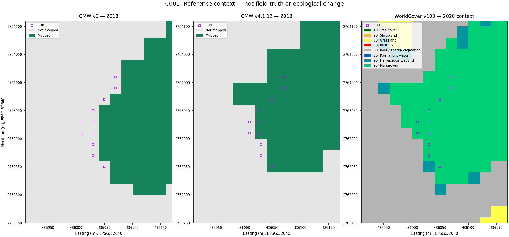

# Mangrove Pulse: C001 inspection brief

Updated 9 October 2026 | Historical demonstration | Status: unresolved

## Purpose and location

**Question:** What land cover occupied C001's cells in November 2018, and can independent evidence explain the disagreement between the satellite baseline and the reference map?

This brief is intended for a mangrove monitoring practitioner reviewing satellite evidence. Its usefulness to that team has not been tested.

**Location:** Khor Kalba, within the provisional study rectangle. Locator: **24.990183° N, 56.366522° E (WGS84)**, the centre of recorded cell row 88, column 83. This is one of 11 cells, not the cluster centroid or a survey boundary. The [cell register](../examples/audit/all_audit_cells.csv) contains every location; filter `cluster_id` to `C001`.

## Recorded evidence (RESULT)

| Item | Saved result |
|---|---|
| Primary image and reference | Sentinel-2, 20 November 2018; Global Mangrove Watch (GMW) v3, 2018 extent |
| Reason for review | The baseline predicted positive for 11 cells not mapped by the original GMW v3 reference |
| Repeat observation | On 30 November 2018, 10 of those cells retained the disagreement; one agreed with GMW; none were excluded |
| Boundary context | Nine of the 11 cells were adjacent to a GMW transition under the audit definition |
| Example selection | Largest cluster in this disagreement category by cell count; this is not a validated inspection-priority score |

The baseline applies a frozen threshold of 0.49 to raw-DN red/NIR contrast. It is not calibrated NDVI or a health measurement. C001 lies in the southern evaluation area. Adjacency means any of eight neighbouring 20 m cells has a different GMW label.

In the [comparison panels](../examples/audit/predicted_positive_reference_negative_examples.png), C001 is the top row: 20 November on the left and 30 November on the right. Cyan circles mark the same 11 primary-date cells in both panels, and orange marks GMW boundaries. The background shows NIR digital values rather than natural colour; brightness alone does not identify mangrove. The bottom row shows C002.

## Additional reference context (RESULT)

The separate [reference-sensitivity comparison](REFERENCE_SENSITIVITY.md), completed in Colab on 1 October 2026, retains the same 11 original case centres. GMW v3 2018 maps none; GMW v4.1.12 2018 maps seven and leaves four not mapped. WorldCover 2020 assigns its mangrove class to all eleven.

The different counts show sensitivity to reference choice; they do not confirm seven corrected labels. The GMW releases share lineage and differ in representation, resolution and sampling. WorldCover uses GMW auxiliary input and describes a later year, so it cannot independently establish November 2018 cover. The original predictions and categories are unchanged.

The outlines mark the original case centres. Read the legend and dates: the colours describe map classes, not health or planting suitability. The [augmented audit register](../examples/reference_context/audit_cells_with_context.json) lists each centre's values.

## Evidence needed (PROPOSED)

GE01 metadata at the locator records a 5 October 2018 capture, 1.2 m source resolution, 8.47 m stated positional accuracy and a 14 October 2020 archive release. The capture is 46 and 56 days before the Sentinel dates. This metadata is confirmed at one point; full-cluster metadata and relative alignment remain unmeasured. The [saved response](../evidence/metadata/C001_2020-10-14_response.json) contains the query result.

The [earlier qualitative review](../examples/review/case_reviews.json) describes cells along a vegetation edge and over canopy-like texture in the team's basemap views. These descriptions remain unverified as mangrove labels; this brief does not record a fresh image review.

Request dated cover labels and measured alignment from imagery or survey records detailed enough to distinguish canopy, other vegetation, water and exposed ground across the cells and surrounding area. Record the source's independence, acquisition date, spatial detail, positional uncertainty and visibility limits. Publication and viewer-release dates cannot substitute for the acquisition date.

A current visit could test collection and record present conditions through dated, geolocated photographs, qualified vegetation identification, canopy-edge observations and visible water conditions. Each record needs its observation time and location uncertainty. It would not directly validate 2018 cover.

The [Khor Kalba handoff](DRONE_KHOR_KALBA_HANDOFF.md) contains all 11 C001 centres, canopy-edge questions and blank observation returns. Existing imagery or ordinary RGB photography may suffice. The amphibious drone remains a concept, with no demonstrated inspection or engineering capability, and this cover question does not establish a need for it.

## Acceptance and decision contract (PROPOSED, not executed)

The decision is whether evidence supports a historical cover interpretation for a particular cell or leaves it unresolved. It does not select planting or aircraft deployment. No observations have passed the proposed checks below. They supplement the [handoff contract](DRONE_KHOR_KALBA_HANDOFF.md#observation-contract-and-acceptance-gates--proposed) and are not enforced by the blank-package validator.

| Link | C001-specific requirement |
|---|---|
| Problem and EO evidence | Eleven original positive-prediction/GMW-v3-not-mapped cells, with repeat-date and reference-choice sensitivity, require interpretation rather than a damage diagnosis. |
| Method and result | Inspect the frozen contrast threshold, saved panels and exact cell register. The demonstrated result is disagreement and its lineage, not cell truth. |
| Uncertainty and requested observation | Seek independently sourced, dated cover evidence across each reviewed 20 m cell and its surrounding edge, with qualified vegetation identification, visible coverage and measured/justified alignment. |
| Platform choice | For historical truth, assess licensed archived imagery or dated survey records first. For a separate current inspection, compare shore/boat photography and ordinary RGB aerial imagery. Amphibious contact sensing is not required by this cover question. |
| Decision consequence | Accept only a supported interpretation for the identified cells/date; otherwise retain unresolved. No site-wide accuracy score, present ecological diagnosis or intervention follows from this selected case. |

Before inspecting new evidence, define the cover label, admissible dates, spatial support and registration requirements, and treatment of mixed or hidden cover. Canopy presence is not automatically equivalent to the classifier's binary output or a GMW extent label. Set the rules before seeing which interpretation best matches predictions. Resolving this selected case would still be exploratory; independent accuracy requires the separate [probability-sampling protocol](VALIDATION_AND_BENEFIT_TESTS.md#2-independently-assess-the-historical-map).

A historical interpretation needs each of the following documented checks:

- Record the source identifier, original acquisition date, permitted use, interpreter and independence from predictions and GMW. Source independence and interpreter blinding are different checks. Because this brief shows predictions, it cannot serve as a blind annotation sheet.
- Establish temporal relevance: the evidence must cover the target period, or a justified transfer argument must address the interval and possible change. The 5 October capture alone does not establish November cover, and current photographs cannot do so.
- Locate the observed area, not just the camera. The evidence must support the claimed portion of the cell after accounting for alignment and occlusion uncertainty. An unscaled oblique photograph, geotag or species occurrence alone cannot label whole-cell cover.
- Apply the predeclared definition, record ambiguous, mixed or hidden portions, and cite the evidence for a reviewable cell-specific conclusion. Keep the label unresolved when the evidence cannot distinguish alternatives.

| Evidence outcome | Permitted follow-up decision |
|---|---|
| No qualifying historical evidence, conflicting sources or inadequate coverage/alignment | Keep historical truth unresolved; request the specific missing evidence or stop this historical branch if access is infeasible. |
| Qualified evidence supports a defined cover interpretation at the relevant date | Record that scoped interpretation and compare it with the saved prediction/reference under compatible definitions. Preserve the original outputs; do not declare a cause of disagreement from the label alone. |
| Only accepted present-day evidence is obtained | Record a separate current-date observation and whether the collection workflow worked. Leave November 2018 truth and original scores unchanged. |
| A proposed collection method fails quality, permission, recovery or habitat gates | Reject or redesign that method; consider the simpler alternative or no visit. An unobserved cell is not a negative label. |

This brief contains the proposed decision rules. The reading notebook provides the historical figures and points here for the full evidence contract.

## Follow-up review record (UNFILLED)

| Field | Current entry |
|---|---|
| Reviewer and review date | Not assigned / not completed |
| Additional map context | GMW v4.1.12 2018 and WorldCover 2020 comparison completed; independent labels remain uncollected |
| Additional independent cover labels | Not collected; map context, earlier metadata and qualitative review do not resolve cell truth |
| Field observations | Not collected for this brief |
| Follow-up interpretation and supporting evidence | Not assessed; earlier qualitative interpretation remains unverified |
| Outcome and remaining uncertainty | Unresolved; cause unverified |

Each conclusion should identify the supported cells, the evidence's temporal relevance and remaining uncertainty. Keep "unresolved" where the evidence is inadequate.

## Interpretation limits and provenance

Disagreement does not establish model error, reference error, ecological damage or planting need. Boundary adjacency does not establish a cause. Two dates from the same sensor are a sensitivity check, not independent validation; the GMW 2018 epoch is not an exact match to either acquisition date.

Prepared from the cached audit: [cluster record](../examples/audit/all_clusters.csv), [audit definitions](../examples/audit/audit_summary.json), and [frozen method](../examples/baseline/frozen_experiment_plan.json), with the separate completed Colab comparison added. Documentation integration uses returned results; no local geospatial processing or field evidence collection was performed.

Contains modified Copernicus Sentinel data (2018). GMW v3, GMW v4.1.12 and WorldCover derivatives carry their source attribution; see [attribution and modifications](../ATTRIBUTION.md). The linked evidence is included in this repository.
