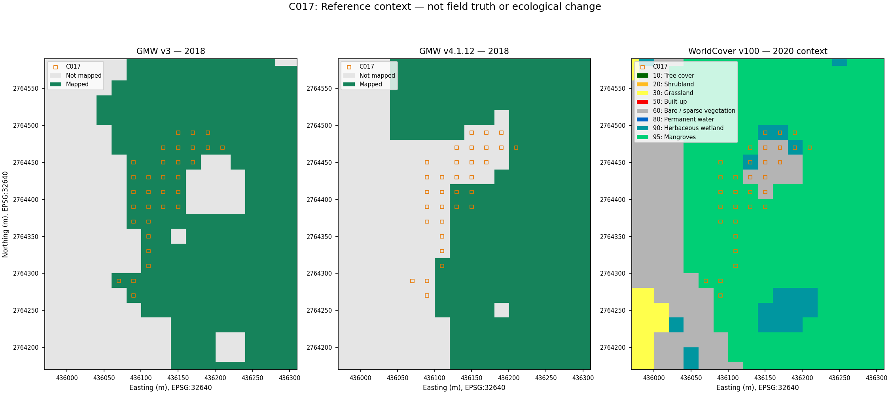

# Mangrove Pulse: C017 inspection brief

2 October 2026 | Historical demonstration | Status: unresolved

## Purpose and location

**Question:** Which cells contain canopy, mixed vegetation, water or open ground at the relevant historical date, and what evidence can explain the reference disagreement?

This brief is intended for a mangrove monitoring practitioner. Its usefulness has not been tested, and field access is unconfirmed.

Locator: **24.994521° N, 56.367293° E (WGS84)**, recorded cell row 64, column 87. This is one of 32 centres, not a cluster centroid, access point or survey boundary. Filter `cluster_id=C017` in the [original register](../examples/audit/all_audit_cells.csv) for all coordinates.

## Recorded evidence (RESULT)

- November 20, 2018: 32 predicted-negative/GMW-v3-mapped cells; 20 adjacent to a reference transition.
- November 30: all 32 retained their original disagreement; none were excluded.
- Separate GMW 2018 comparison: v3 maps 32 centres; v4.1.12 maps six. Twenty-six are mapped only by v3.
- Later WorldCover 2020 context: 21 mangrove-class centres, seven bare/sparse vegetation and four herbaceous wetland.

The baseline applies threshold 0.49 to raw-DN red/NIR contrast. This is not calibrated NDVI or a health measurement. The original categories and predictions are unchanged. The reference counts differ, but neither map provides independent cell truth.

The team's earlier basemap review described patchy vegetation and lighter open cover. GE01 metadata at one case locator reports a 5 October 2018 capture, 1.2 m imagery resolution and 8.47 m positional accuracy. The provider's resolution field does not independently verify native sensor resolution. Metadata across the full cluster and relative layer alignment remain unmeasured. See the [case register](CASES.md) and [metadata response](../evidence/metadata/C017_2020-10-14_response.json).

## Evidence request (PROPOSED)

Request independent dated cover labels and measured alignment for all 32 centres and their surroundings. Record canopy identity and extent, other vegetation, water, exposed ground, visibility and positional uncertainty. Include mixed-cover fractions only where the evidence supports them, and distinguish acquisition dates from annual map epochs.

A current inspection could record dated, geolocated photographs and vegetation identified by a qualified observer. It could test collection but would not directly validate 2018 cover. Document access, safety and required observation quality before choosing a method. The amphibious drone remains an untested option, not the preferred method.

## Follow-up record (UNFILLED)

The [handoff package](DRONE_KHOR_KALBA_HANDOFF.md) retains all 32 centres and requests cover composition, visibility and alignment uncertainty. Simpler collection methods should be compared before requiring amphibious hardware. All observation returns are empty.

| Field | Current entry |
|---|---|
| Practitioner and review date | Not assigned / not completed |
| Independent historical labels and alignment | Not collected / unmeasured |
| Field observations and access | Not collected / unconfirmed |
| Cell-specific conclusions and sources | Unresolved |
| Workflow feedback and remaining uncertainty | Not collected |

These are 32 disagreements, not confirmed model misses. Their cause, any damage or tidal effect, and planting need remain unresolved. The GMW versions share lineage and differ in representation, resolution and sampling. WorldCover is later context with GMW auxiliary input. Agreement with these maps is not field accuracy.

Provenance: [original clusters](../examples/audit/all_clusters.csv), [audit definitions](../examples/audit/audit_summary.json), [returned case comparison](../examples/reference_context/case_comparison.json), [supplement methods](REFERENCE_SENSITIVITY.md) and [source attribution](../ATTRIBUTION.md). Prepared from cached/returned evidence; no local geospatial processing or field collection was performed.
