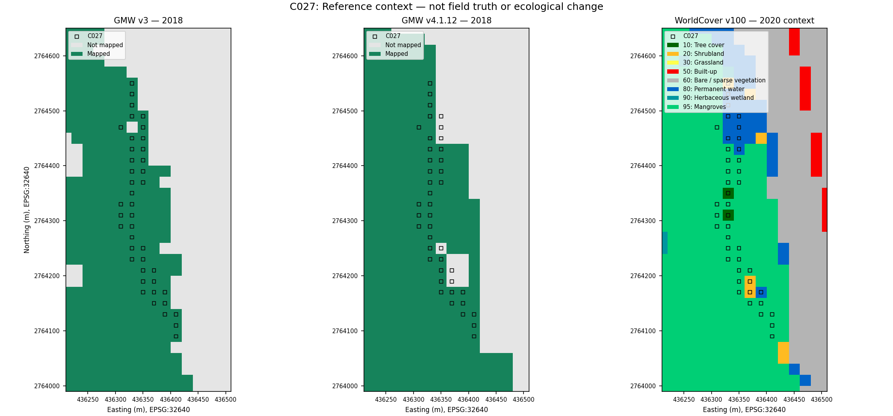

# Mangrove Pulse: C027 inspection brief

2 October 2026 | Historical demonstration | Status: unresolved

## Purpose and location

**Question:** What cover evidence and quality information can explain the gap in usable satellite observations along this mapped channel margin?

This brief is intended for a mangrove monitoring practitioner. Its usefulness has not been tested, and field access is unconfirmed.

Locator: **24.995070° N, 56.369073° E (WGS84)**, recorded cell row 61, column 96. This is one of 42 centres, not a cluster centroid, landing site or survey boundary. Filter `cluster_id=C027` in the [original register](../examples/audit/all_audit_cells.csv) for all coordinates.

## Recorded evidence (RESULT)

- November 20, 2018: 42 quality-excluded/GMW-v3-mapped cells; 18 adjacent to a reference transition. These have no evaluated prediction under the quality gate.
- November 30: 40 remained excluded; the original cluster record reports 40 in the same audit category. This is not 42 evaluated prediction errors.
- Separate GMW 2018 comparison: v3 maps all 42 centres; v4.1.12 maps 36. Six are mapped only by v3.
- Later WorldCover 2020 context: 28 mangrove-class centres, nine permanent water, three shrubland and two tree cover.

The frozen baseline and quality rule are unchanged. SCL classes 4/5/6 are eligible; other classes and missing inputs are excluded. Reference-map context does not override the rule or explain why a cell's classification or input failed it.

The team's earlier basemap review described a long strip along a dark channel and vegetation margin. GE01 metadata at one case locator reports a 5 October 2018 capture, 1.2 m source resolution and 8.47 m positional accuracy. Metadata across the full cluster and relative layer alignment remain unmeasured. See the [case register](CASES.md) and [metadata response](../evidence/metadata/C027_2020-10-14_response.json).

## Evidence request (PROPOSED)

Review each cell's SCL class, input validity and optical context at both Sentinel dates, alongside independent dated cover labels and measured alignment. Record canopy and vegetation edges, water, open cover, visibility and uncertainty. Exclusion alone does not identify a physical cause such as tide, cloud shadow or damage.

A current inspection could collect dated, geolocated photographs of the channel margin and vegetation identified by a qualified observer. Safe-access requirements must be recorded first. Such observations would describe current conditions and test collection, not directly validate 2018 cover. A drone is one possible method; the maps establish neither amphibious access nor safe operation or observation quality.

## Follow-up record (UNFILLED)

The [handoff package](DRONE_KHOR_KALBA_HANDOFF.md) retains all 42 centres. Historical quality review and future channel-edge observations are separate tasks. Water-supported contact sensing needs its own current justification; these exclusions do not establish that need. The targets are not approved sampling or landing locations, and no field observations have been collected.

| Field | Current entry |
|---|---|
| Practitioner and review date | Not assigned / not completed |
| Independent historical labels and alignment | Not collected / unmeasured |
| Screening cause and supporting evidence | Unverified |
| Field observations and access | Not collected / unconfirmed |
| Cell-specific conclusions and workflow feedback | Unresolved / not collected |

GMW v4 maps 36 centres, which supports retaining the coverage question but does not confirm local mangrove truth. The GMW versions share lineage and differ in representation, resolution and sampling; WorldCover is later context with GMW auxiliary input. Ecological diagnosis, planting need, drone advantage and urgency remain unestablished.

Provenance: [original clusters](../examples/audit/all_clusters.csv), [audit definitions](../examples/audit/audit_summary.json), [returned case comparison](../examples/reference_context/case_comparison.json), [supplement methods](REFERENCE_SENSITIVITY.md) and [source attribution](../ATTRIBUTION.md). Prepared from cached/returned evidence; no local geospatial processing or field collection was performed.
