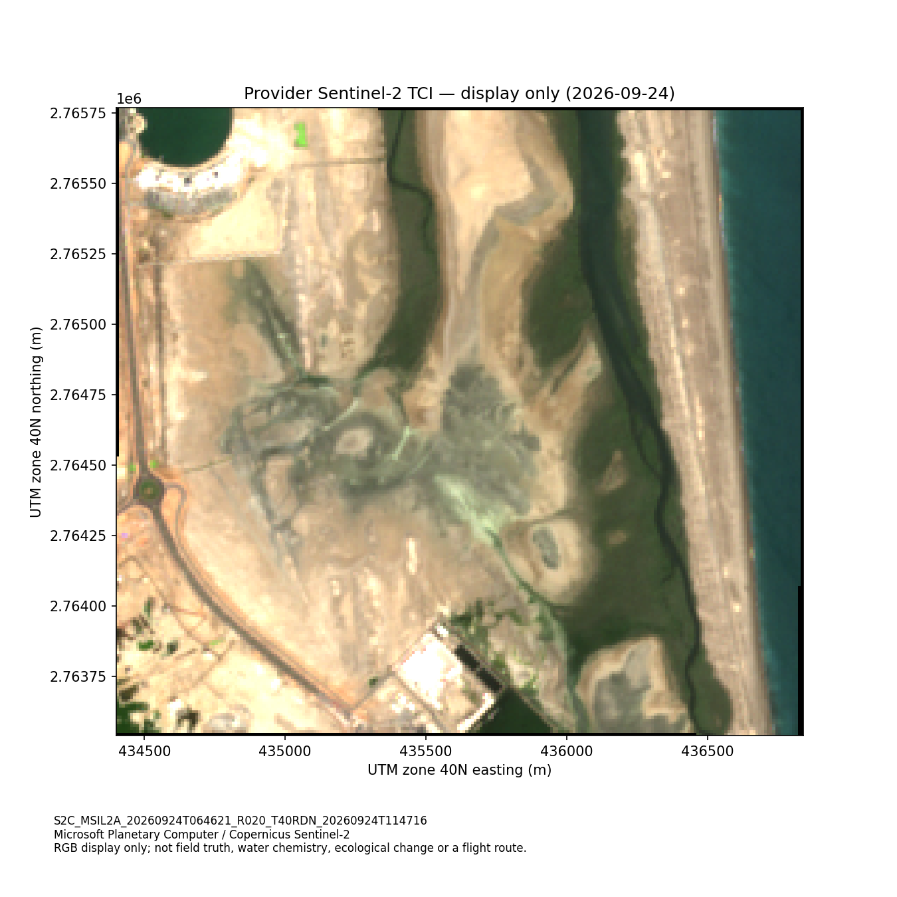
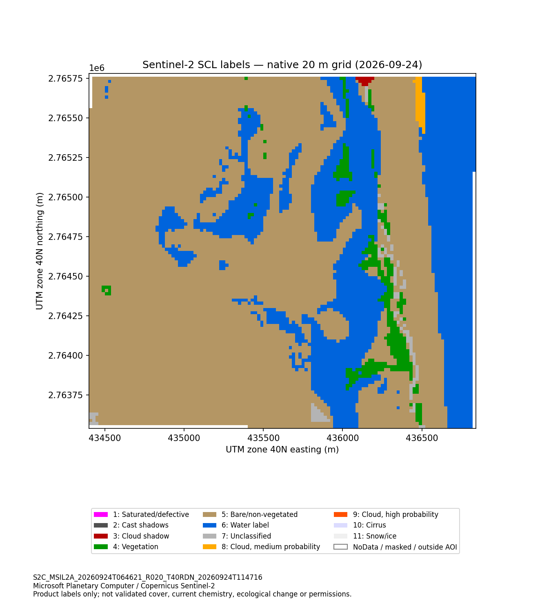

# Dated Khor Kalba context and the proposed observation task

8 October 2026 | MP-KALBA-RECENT-CONTEXT-02 | Context-only result

The frozen 2018 cases demonstrate how to turn satellite/reference uncertainty into an observation request. A separate Sentinel-2C observation from 24 September 2026 supplies dated site context. Neither result establishes an amphibious aircraft, a water-chemistry diagnosis or a planting recommendation.

## Data obtained

One free-CPU Colab run produced small native windows from item `S2C_MSIL2A_20260924T064621_R020_T40RDN_20260924T114716`, processing baseline 05.13, through Microsoft Planetary Computer. The study rectangle is `[56.350, 24.986, 56.374, 25.006]`, not an official reserve boundary.

The provider's uint8 true-colour image (TCI) is displayed without an additional adaptive stretch. This 10 m display product is neither quantitative reflectance nor evidence of species, water chemistry or health. Its enclosing crop is 223 rows by 244 columns; 756 pixels are masked or outside the AOI.

The 20 m scene-classification layer (SCL) is shown on its native grid, with the study rectangle's pixel-centre membership retained. The enclosing crop is 112 rows by 122 columns. The [actual report](../examples/recent_context/class_context_report.json) records these labels among 13,401 AOI centres:

| Provider label | Native 20 m cells |
|---|---:|
| Cloud shadow, class 3 | 12 |
| Vegetation, class 4 | 387 |
| Not vegetated, class 5 | 9,316 |
| Water, class 6 | 3,525 |
| Unclassified, class 7 | 117 |
| Medium-probability cloud, class 8 | 44 |

Other class counts and masked/NoData counts were zero in this crop. The table counts product labels, not validated cover. Generic vegetation is not a mangrove class, and a water label supplies neither depth nor navigability. The [provider's SCL documentation](https://sentiwiki.copernicus.eu/web/s2-processing) describes broad scene categories and quality screening rather than independent field labels. Comparing these counts with 2018 GMW/prediction counts cannot establish gain or loss.

## How this connects to the drone without inventing a mission

| Evidence track | Missing observable | Appropriate comparison |
|---|---|---|
| Historical C001/C017/C027 cover review | Independent dated 2018 cover and measured alignment | Archival evidence; a current drone cannot directly establish historical truth |
| Separately dated photographic inspection | Current geolocated canopy/edge photographs and qualified identification | Existing imagery, shore/boat photography and ordinary RGB drone first |
| Site-level water-contact question | Calibrated conductivity/temperature, with station, depth, time and tidal context | Shore/boat probes, loggers, USVs, hovering probe delivery and water-supported delivery for the same accepted record |

The [historical local water-property evidence](WATER_CONTACT_RATIONALE.md) motivates the third question. The images supply dated spatial/display context only. They cannot define C001 as a present sampling station, diagnose chemistry from C027's historical exclusion, establish access or determine safe landing positions. The experiment generated no historical-case overlay or route.

The proposed mechanism is air transport followed by water-supported probe dwell, only if a simpler method cannot meet the task safely. It must deliver equivalent usable observations, stable measurement, safe transitions/recovery and habitat/access compliance. For equal attempted tasks and common acceptance rates, both energy and time per accepted record improve only when `pS/pH > max(ES/EH, TS/TH)`. The [executed analytical companion](../supplementary/Mangrove_Pulse_Supported_Sensing_Envelope_Executed.ipynb) checks that algebra and counterexamples. Required physical inputs and measured acceptance/resource values remain unknown.

The [water-question contract](../examples/inspection/water_context_question.json) still has no stations or observations. The ecological/intervention track remains [separate](VALIDATION_AND_BENEFIT_TESTS.md). Keep the aircraft only if a quality-matched comparison supports it; current EO context does not select a winner.

## Evidence preservation and bandwidth

The [successful status](../examples/recent_context/status.json), [runtime versions](../examples/recent_context/runtime_versions.json), exact source/specification/public unsigned item, figures and [native crop cache](../examples/recent_context/native_context_cache.npz) are preserved unchanged with the [returned manifest](../examples/recent_context/manifest.json). The original returned ZIP is 514,052 bytes, SHA-256 `dd619bf656ada60a291fa88690bcd4036edd3d9a3514f443e1137a49dd9d9c92`; the cache is 146,303 bytes, SHA-256 `1f89eff69db90f6cecc2021cdbeb090bc23d1f4059d43c2063926eb9453df589`.

The saved figures/report can be read without a runtime. Avoid rerunning the acquisition source: its duplicate-attempt marker is runtime-local and does not survive a Colab reset. The source supports audit, not offline cache rendering. Future geospatial work must use the retained cache in free Colab rather than re-fetch these assets. The acquisition notebook was saved and its completed runtime ended; access/sharing remains a separate delivery requirement. No calibration-index experiment, model fitting or historical retuning was performed.

The separate [cache-only replay notebook](../supplementary/Mangrove_Pulse_Offline_Context_Replay.ipynb) completed on free CPU Colab with 28 passing cache checks (Python 3.13.16, NumPy 2.1.3). Its prepared local source retains empty output cells; the [1,396-byte report ZIP](../supplementary/Mangrove_Pulse_Offline_Context_Replay_Report.zip) records actual execution. The reader reproduces native product-label and mask counts using saved AOI membership, without independently recalculating or validating that membership. It made no imagery/API requests and performed no calibrated-index calculation, model fitting or figure regeneration. Only the small report was downloaded once; the source cache and images were not downloaded again. The reader is [included for audit](../src/offline_context_reader.py). Replay establishes reuse/reproducibility rather than additional field or aircraft evidence.

Contains modified Copernicus Sentinel data (2026), accessed through Microsoft Planetary Computer. See [attribution and modifications](../ATTRIBUTION.md) and the [rights notice](../LICENSE_NOTICE.md). No provider endorsement is implied.
