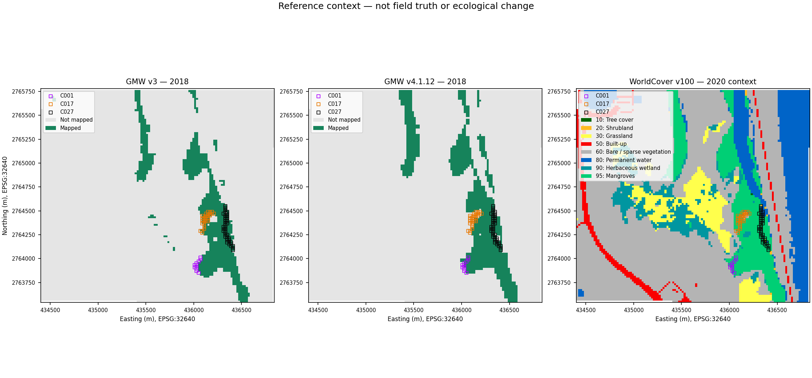

# Reference sensitivity and later-date context

Experiment MP-REFERENCE-SENSITIVITY-01. Calculation completed in the team's Google Colab session on 1 October 2026; results reviewed and integrated on 2 October. This is a separate descriptive comparison, not new model fitting or field validation.

## Question and method

How does the reference representation affect the historical inspection cases?

The comparison retains the original 20 m EPSG:32640 grid, 13,401 AOI centres, audit rows and case populations. It compares cached GMW v3 2018 raster labels with GMW v4.1.12 2018 vector point membership at those exact centres; polygon boundaries count as mapped. WorldCover 2020 v100 categorical classes come from the containing native pixel after coordinate transformation. Classes are not interpolated, layers are not shifted, and invalid geometry must not be repaired silently.

This population spans the full AOI without the baseline's southern/quality gate. It differs from the 5,653 eligible southern cells in the original November 20 evaluation. No threshold, split, prediction, category or baseline score is replaced. The original frozen threshold remains 0.49, with the original north/south split and 200 m gap.

## Results

| GMW 2018 membership | Centres |
|---|---:|
| Neither representation | 11,806 |
| v3 only | 177 |
| v4.1.12 only | 437 |
| Both | 981 |

The representations differ at 614 / 13,401 = 4.58% of all AOI centres. Mapped Jaccard is 981 / 1,595 = 0.6150. Among centres mapped by either reference, 614 / 1,595 = 38.50% differ. The background-heavy full-AOI denominator and the mapped-union denominator answer different questions.

| Case | Centres | v3 mapped, 2018 | v4.1.12 mapped, 2018 | WorldCover mangrove class, 2020 |
|---|---:|---:|---:|---:|
| C001 | 11 | 0 | 7 | 11 |
| C017 | 32 | 32 | 6 | 21 |
| C027 | 42 | 42 | 36 | 28 |

C001's original outside-reference label is sensitive to reference choice. C017 cannot be described as 32 confirmed missed mangrove cells: 26 are no longer mapped in the newer representation. C027 retains mapped status at 36 of 42 centres, leaving observation coverage an investigation question. These statements describe reference membership, not which map is correct.

Case maps and evidence requests: [C001](C001_INSPECTION_BRIEF.md), [C017](C017_INSPECTION_BRIEF.md), [C027](C027_INSPECTION_BRIEF.md).

## What this does and does not establish

- Reference choice affects the three previously selected cases. They are descriptive, post-hoc examples, not fresh validation samples.
- GMW annual epochs are not exact November acquisition dates. The releases share lineage and differ in resolution, representation and sampling; no single cause of the discrepancies is identified.
- WorldCover 2020 is later-date context, using Sentinel-1/Sentinel-2 and GMW auxiliary input. It is not independent November 2018 truth. Its InputQuality layer was not supplied; a class value does not provide local certainty.
- Counts are sampled grid-centre labels, not native pixel counts, canopy fractions, verified area, growth or loss. GMW not mapped does not prove absence.
- Independent dated cover labels, measured layer alignment, field access and practitioner feedback remain missing. A present-day visit cannot directly establish 2018 cover.
- The comparison does not establish ecological stress, damage, planting need, carbon benefit or an advantage for the proposed drone. Observation methods must be compared against the actual inspection requirements.

## Returned evidence and verification

The included [comparison summary](../examples/reference_context/comparison_summary.json), [case summaries](../examples/reference_context/case_comparison.json), [208-row augmented audit register](../examples/reference_context/audit_cells_with_context.json) and four PNG maps are returned Colab outputs. Original audit fields are retained; new context fields are additions. Original data and model outputs remain in their existing folders.

The [completed run status](../examples/reference_context/run_status.json), [16-test log](../examples/reference_context/synthetic_tests.log) and [24 data checks](../examples/reference_context/data_checks.json) record execution in Colab. Tests check implementation/data invariants, not ecological correctness. Local integration checks compare hashes, JSON arithmetic, notebook syntax and links; they do not rerun the scientific calculation.

Source archive SHA-256: `6c55816485e9b3a27e8cd12338f919e88e189e73f06ba97bb8d0a80ce31cbd37`. The unchanged original ZIP is preserved outside this submission. Its final-cell rerun left a duplicated/self-hashed manifest and a stale failure note. All 42 unique non-manifest payload hashes and ZIP CRC passed review; the exceptions concern packaging, not the source/maps/tables. This curated supplement excludes those stale packaging files. [Its extraction record](../examples/reference_context/INCLUDED_PAYLOADS.json) and the repository SHA256SUMS.json cover the included bytes without self-hashing.

The returned [method plan](../examples/reference_context/METHOD.md) says unexecuted because it was written before the run; the completed status above supersedes that historical status. The exact returned calculation source and tests are included for inspection. The recorded `scientific_results_verified_locally: false` means no local scientific rerun; it does not mean the returned archive was left unreviewed.

## Reviewing saved results and reproducing the experiment

The saved tables, maps and briefs can be reviewed without uploads, provider accounts or a new Colab run.

For a separate future reproduction, open [Mangrove_Pulse_Reference_Context.ipynb](../supplementary/Mangrove_Pulse_Reference_Context.ipynb) in Colab with a fresh standard CPU runtime. This self-contained supplementary notebook embeds the five frozen small inputs. It requests only these provider files, verified against the [source manifest](../examples/reference_context/uploaded_source_manifest.json):

- `gmw_v4112_2018_mng_ext_cntry_info_vec.gpkg.gz`: GMW v4.1.12 2018, [provider record](https://doi.org/10.5281/zenodo.21346457).
- `ESA_WorldCover_10m_2020_v100_N24E054_Map.tif`: [WorldCover data access](https://esa-worldcover.org/en/data-access).

Its isolated dependencies are separate from the core PoC requirements; do not merge the Rasterio pins or replace the main notebook. No satellite bands, XML, screenshots, Drive mount or API key are needed. The final cell exports fresh results or diagnostics. The saved notebook is unexecuted and contains permanent plotting/packaging fixes added after the successful run. Its source bytes therefore differ from the exact returned source; scientific sampling/calculations are unchanged. The earlier source completed using an Agg environment workaround. A future hosted rerun of this repaired notebook has not been performed here.

Sources, CC BY 4.0 attribution and modifications are recorded in [ATTRIBUTION.md](../ATTRIBUTION.md) and the [returned attribution](../examples/reference_context/ATTRIBUTION.md). WorldCover's [v100 manual](https://esa-worldcover.s3.eu-central-1.amazonaws.com/v100/2020/docs/WorldCover_PUM_V1.0.pdf) documents its auxiliary inputs. No provider endorsement is implied.
