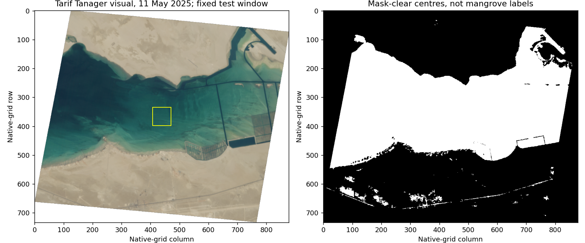

# Tarif hyperspectral source qualification

Separate experiment executed 9 October 2026. The frozen Khor Kalba 2018 analysis, threshold, split and results are unchanged.

## Outcome and site decision

The experiment read Planet Tanager surface-reflectance channels from a predeclared 64 × 64 scene-centre window near Tarif, Abu Dhabi. Bounded HTTP ranges avoided downloading the full 1.11 GB cube. Visual inspection shows open water in the window. This establishes access to the data and one crop, not a mangrove classifier, independent accuracy, hyperspectral improvement or a better demonstration site.

Khor Kalba remains the primary executed demonstration. This single window cannot establish that the whole Tarif scene lacks mangroves or rule out a better UAE site. A site switch requires matched species/cover evidence, independently qualified labels and an executed useful comparison. The historical workbook mismatch rejects that particular pairing, not all evidence around Tarif.

The yellow window is the test location, not an inspection target. The mask panel shows provider screening, not field-verified cloud accuracy. Excluded land is not proof of cloud, damage or mangrove absence.

## Recorded measurements

| Quantity | Result | Interpretation |
|---|---|---|
| Item / date | `20250511_074311_00_4001` / 11 May 2025, 07:43:11 UTC | Separate site/date; not 2018 Kalba validation |
| Orthorectified grid | 733 × 878, 30 m, EPSG:32639 | Native GSD metadata 34.78 m; gridding is not added spatial information |
| Provider metadata cloud | 51% | Scene attribute, not the usable mangrove fraction |
| Mask-clear grid centres | 248,612 / 643,574 (38.63%) | Cloud/cirrus/nodata plus visual-alpha screening of the rectangular grid |
| Fixed window | Row 334, column 407, 64 × 64 | Selected before inspecting masks/contrast; not representative mangrove sampling |
| Usable spectral centres | 4,096 / 4,096 | Finite 0–1 channel values, positive red+NIR sum and quality screening; not field truth |
| Sampled channels | 0.66587, 0.70592, 0.86628 µm | Actual surface-reflectance cube channels; not drone sensing |
| Normalized red/NIR contrast | −0.49248 to −0.18556 | Descriptive window result; no species, health or chemical diagnosis |
| Imagery bytes transferred | 2,216,628 | 905,908 visual/mask bytes + 1,310,720 spectral-range bytes; excludes headers, metadata, HTTPS overhead and notebook/results transfers |

The spectral read used 40 cached 32,768-byte blocks under a 12 MiB ceiling. Requests require HTTP 206, exact Content-Range/length and If-Match. Cache directories bind URL and ETag; stale lengths are rejected. There is no full-file GET fallback. The cube has 426 channels, float32 values and gzip chunks of 14 × 46 × 55; only three channel planes in this window were used, not a full hyperspectral model or uncertainty analysis.

## Connection to the drone

The accessible optical observation is separate from the proposed contact-sensing task. These three reflectance channels provide no validated conductivity/temperature station record and cannot diagnose a water problem or select an amphibious vehicle.

The [existing water-contact comparison](WATER_CONTACT_RATIONALE.md#one-refutable-task-comparison) must first justify a decision, authorized station, measurement chain and accepted observation. Then compare shore/boat/logger/USV/ordinary-hover and supported delivery on equivalent observations, complete resources and disturbance. The [question contract](../examples/inspection/water_context_question.json) still has no collected observations. This experiment supplies no physical drone superiority, ecological benefit, planting need or independent historical cover accuracy.

## Inspect and reproduce without repeat acquisition

- [Actual executed notebook](../supplementary/Mangrove_Pulse_Tarif_Scene_Qualification_Executed.ipynb): one successful science cell, visible figure/report and no Python error output.
- [Returned results/cache ZIP](../examples/tarif_qualification/results.zip): 2,688,433 bytes; all 47 members passed CRC and safe-relative-path review.
- [Report](../examples/tarif_qualification/qualification.json), [environment record](../examples/tarif_qualification/environment.json) and figure above: inspect without starting a runtime.
- [Open the team-owned executed notebook in Colab](https://colab.research.google.com/drive/1WyvXcvkeuMS8bGgrxQjJ35cRuLKw3Ggk), or read the repository copy linked above.

Notebook SHA-256: `246f9bbfe9b831f2d11404b3255155a57635cd60de4e7d8d00b4bc9720799900`. ZIP SHA-256: `73e2cd5eb77ff57179711cad9766ad56b73dd2b0eb0fd6663d7e00028c1dacf9`. Metadata SHA-256: `b0ad2085835feb03cd60f768e41c6d1e9377f3aa59a34e6908e9f2e84a898eda`.

For an authorized free-Colab replay, unpack the ZIP contents directly into `/content/mangrove_tarif_qualification` **before** running the science cell; this preserves its input and range-cache paths. The frozen item metadata is embedded. On a fresh runtime without the retained cache, the notebook makes online imagery requests; do not run merely to read outputs. Cached replay was not separately executed. Local checks were source/JSON/CRC/hash inspection, not a local scientific rerun.

Successful runtime versions: Python 3.13.16; requests 2.32.4; h5py 3.14.0; NumPy 2.1.3; Pillow 11.3.0; Matplotlib 3.10.0. A later metadata-only Colab cell recorded these versions without another scientific run or imagery request. The exact downloaded notebook/ZIP predate that additional cell and are unchanged. Earlier saved review notebooks also predate this supplement; their original no-hyperspectral wording describes their own completed Kalba scope.

## Attribution

Planet Tanager open data, [specific primary STAC item](https://www.planet.com/data/stac/tanager-core-imagery/coastal-water-bodies/20250511_074311_00_4001/20250511_074311_00_4001.json), provider-labelled [CC BY 4.0](https://creativecommons.org/licenses/by/4.0/). Modifications: fixed-window channel extraction, normalized contrast, visual/beta-mask display and range caching. No endorsement or suitability warranty is implied. The archive retains its original catalogue attribution; the specific item is linked here. Data rights do not select a licence for the team's original code.
